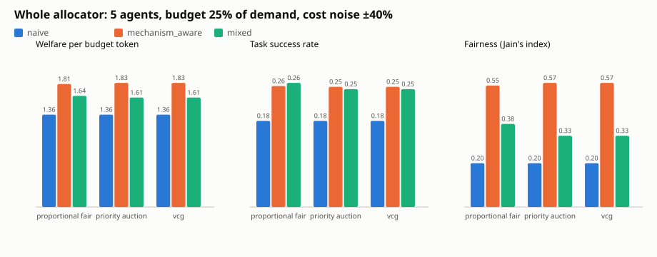

# Mechanism-Aware Multi-Agent LLM Resource Allocation

N agents share one fixed token budget. An explicit mechanism splits it: **proportional fairness** (primary), **priority auction** or **VCG** (baselines). We compare **mechanism-aware** agents with **naive** agents, which request greedily. We also compare two allocator designs:

- **Split:** the allocator may hand out partial grants.
- **Whole:** partial grants are pooled and spent only on complete requests, in priority order.

The simulation uses synthetic, seeded workloads and makes no LLM API calls. Agents only know an *estimate* of each task's cost; the real cost (±40%) is revealed when the task runs, as with real LLM output.

Pure Python 3.10+, standard library only.

## Quick start

```bash
python tui.py                            # menu-driven explorer: walkthrough, comparisons, drill-down, sweeps, settings
python -m unittest discover -s tests     # 11 tests: mechanisms, whole-request mode, budget safety, declines/refunds/retries
python demo.py                           # live walkthrough of three designs (~1 s)
python experiments.py                    # full matrix: 9,720 runs (~6 s) -> results/
```

Demo options: `--agents 10 --budget-ratio 0.5 --noise 0.4 --mechanism vcg --seed 3 --seeds 30`. Use `--noise 0` for exact costs.

## How we test without an LLM

An LLM call does two things that matter to an allocator: it **uses tokens** and it **delivers something of value**. Each simulated task is exactly that pair.

| Real LLM agent | Simulation |
|---|---|
| Input tokens are known; output length is not | Agent sees an `estimate`; the real cost is estimate × uniform(0.6, 1.4), revealed at run time |
| `max_tokens` cap reached → response cut off | Grant smaller than the real cost → tokens used are lost, nothing is delivered |
| Billed per token actually used | A finished task hands its unused grant back to the pool |
| Retry with a higher cap after a cut-off | Aware agents retry with a request 1.5× larger |
| Task outcome worth something to the business | Each task has a value; "welfare" = total value of finished tasks |

Every strategy sees the same tasks for a given seed, and results are averaged over 30 seeds.

## Headline result (5 agents, 30 workloads, budget = 25% of demand, costs ±40%)



| Design | Value / budget token | Tasks done | Fairness (Jain) | Wasted | Left unused |
|---|---|---|---|---|---|
| Proportional fair, split, naive agents | 0.78 | 14% | **0.98** | 65% | 0% |
| Proportional fair, split, aware agents (they decline partial grants) | 0.49 | 10% | 0.54 | 1% | 75% |
| **Proportional fair, whole, aware agents** | **1.81** | **26%** | 0.55 | **4%** | 10% |
| VCG, split, naive agents | 1.61 | 22% | 0.32 | 21% | 0% |
| VCG, whole, aware agents | 1.83 | 25% | 0.57 | 4% | 9% |

1. **Fair splitting wastes most of a tight budget.** With naive agents, proportional fairness gives everyone a slice too small to finish anything, and 65% of tokens are burned on calls that get cut off.
2. **Declining partial grants alone backfires.** Aware agents stop wasting tokens. But proportional fairness keeps re-splitting the same thin slices, so everyone declines and 75% of the budget is never used.
3. **Pooling into whole requests fixes it.** The allocator collects the partial grants and fully funds the highest-priority requests that fit. Aware agents reserve for the 95th percentile of their cost, keep only what they use and return the rest. Result: 2.3× the value of the fair split, with waste at 4%. This holds at 3, 5 and 10 agents, and with exact costs (1.85).
4. **The trade-off is fairness.** Whole grants are lumpy, so Jain's index drops from 0.98 to 0.55 at a 25% budget. The gap closes as the budget grows (0.84 at 50%, 0.89 at 75%).
5. **Naive agents are punished by the whole-request allocator.** A whole backlog rarely fits, so naive agents get 1.36 value per token against 1.81 for aware agents. The rule itself rewards asking for what you actually need.
6. **The mechanism matters less once requests are whole.** Proportional fairness, the priority auction and VCG all land at 1.81–1.83. VCG payments still drop with aware agents (3,931 → 1,179) because they stop inflating bids.

Full tables: `results/summary.md`. Every run: `results/results.csv`. Per-configuration means: `results/summary.csv`. The split-allocator chart is `results/comparison_split.svg`.

## How it works

| File | What it does |
|---|---|
| `allocation.py` | Three mechanisms behind one interface: `{agent: Bid(request, value_per_token)}, budget, whole -> AllocationResult(allocations, payments)`. Proportional fairness maximizes `Σ bid·log(1+x)` exactly. The priority auction is first-price. VCG charges each agent its externality. With `whole=True`, every mechanism funds complete requests only; proportional fairness pools its partial grants and re-spends the pool by bid priority. |
| `agents.py` | Seeded tasks, each with an estimate, a hidden real cost and a value. **Naive** agents request their whole estimated backlog, bid 2× their best value rate, and run whatever they get. **Aware** agents request their next task × a safety margin (95th percentile of cost error), decline smaller grants, return unused tokens, and retry 1.5× larger after a cut-off. **Mixed**: one naive agent among aware ones. |
| `simulation.py` | Multi-round episode against one hard budget. Agents re-bid each round on what is left; it stops when the budget runs out, the work runs out, or nothing can be funded. An assert guarantees the budget is never overspent. |
| `experiments.py` | Matrix: 2 cost-noise levels × 2 allocators × 3 mechanisms × 3 strategies × {3, 5, 10} agents × {25, 50, 75}% budget × 30 seeds. Writes CSVs, markdown tables and SVG charts. |
| `demo.py` | Round-by-round trace of the three designs on one workload, then every design averaged over 30 workloads. |

Metrics: task success rate, token spend and cost ($3 per 1M tokens), wasted tokens (cut-off calls), unused budget, Jain's index over tokens used, welfare, welfare per budget token, and transfers (auction payments, reported separately from token cost).

See `REPORT.md` for the research framing, the literature and the limitations.
